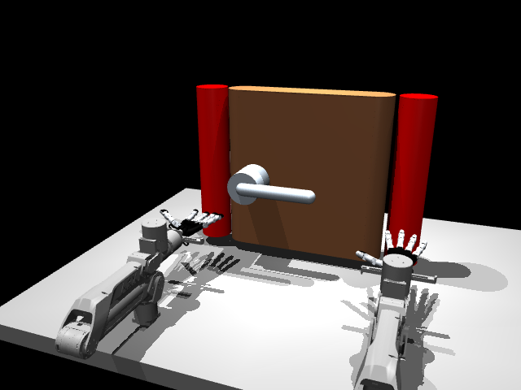

# R03 开门：先把门机构迁入，再接动作与评分

[Adroit Door](https://robotics.farama.org/envs/adroit_hand/adroit_door/) 的任务是操作门闩、推开门。固定版本的[源 MJCF 与许可清单](../asset_manifests/R03-adroit-door-mjcf.json)里，门不是一个独立盒子：门框下挂门板，门板下挂门闩，门轴与门闩各有一个转动关节。源代码用门轴角度达到 1.35 rad 作为成功条件；原环境还随机摆放门框，使用 Adroit 手控制。

本次把 `frame → door → latch` 整段从固定版本源 XML 复制到双 X5/Wuji 的 UniLab 诊断场景，保留三段刚体的质量与惯量、门板和门闩的几何、铰链轴与角度范围，以及关节阻尼、臂惯量和干摩擦损失。门板质量为 2.43455 kg、门闩质量为 3.53743 kg；门轴的 `frictionloss` 为 2，门闩为 5。原 MJCF 默认的几何摩擦 `1 0.5 0.01`、接触 margin 0.0005 m 和关节默认值被显式写入适配场景。源物理步长为 0.002 s、求解迭代和 no-slip 迭代均为 20；原环境每次动作推进 5 步，因此控制周期设为 0.01 s。构建脚本会用 MuJoCo 编译结果复核质量、惯量、关节范围及阻尼，并拒绝初态门机构与机器人穿模。



场景中的门框整体向外平移，避免和两只手在起始时穿插；它与原环境的门框位置及随机 reset 不同。门的木材和金属外观也改成了简单颜色，未复制原贴图。原 Adroit 手、桌子、策略及把手接触过程没有迁入，所以目前只能说“门机构在 UniLab 能按原参数加载和运动”，不能说“开门任务已复现”。官方文档还提到门会受到闭合方向偏置；目前只确认并复制了源 XML 中可直接核对的关节参数，偏置效果需通过后续动作实验单独核验。

[两环境试跑回执](evidence/source-mjcf-20261126/R03/receipt.json)确认场景加载、两步推进和独立重置。[轨迹](evidence/source-mjcf-20261126/R03/traces.json)已经从 UniLab 读出实际 `door_hinge_rad`，而不是填零占位；同时记录了门闩角度。但这只是短探针，轨迹标为 `complete=false`，[评分结果](evidence/source-mjcf-20261126/R03/evaluation.json)及回执中的任务成功仍为 `null`。门闩的阶段成功条件、真实接触力与控制策略还需要继续接线。

准备好仓库要求的 X5/Wuji 机器人资产后，在仓库根目录运行：

```bash
uv sync --locked
uv run --locked python integrations/unilab/task_assets.py fetch --task R03
uv run --locked python -m integrations.unilab.build_proxy_task_scenes --task R03
uv run --locked python integrations/unilab/task_owner.py smoke --task R03 --output runs/R03-smoke --steps 2
uv run --locked python integrations/unilab/play_task.py --task R03 --port 8080
```

生成器不会覆盖已有场景目录。下一步先做能压下门把手并推动门板的动作脚本，观察门闩角、门轴角和手指接触是否形成合理顺序，再复核原环境的随机摆放与闭合偏置。等完整回合和评分信号都就绪，才比较不同物理后端的成功率与耗时。
