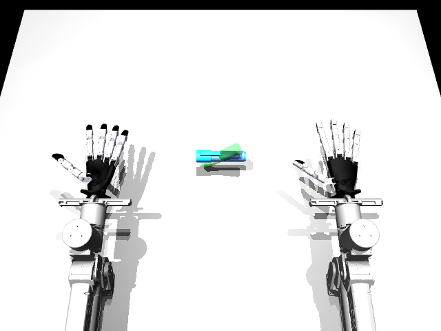

# H02 手内笔：复用原笔物理参数，任务仍需迁移

[Adroit Pen](https://robotics.farama.org/envs/adroit_hand/adroit_pen/) 要求手在掌中调整笔，使笔靠近固定目标点、笔轴对准目标轴。原环境使用 Adroit 手的 24 维关节动作，目标朝向在 reset 时随机选取。它的绿色目标笔是朝向提示：原评分的位置误差比较真实笔的物体坐标原点与 `eps_ball` site，而不是与绿色笔刚体的位置比较。原评分还比较 `object_top/object_bottom` 与 `target_top/target_bottom` 所定义的两个单位轴的点积；绕笔自身长轴旋转不影响这个轴向指标。

[固定版本源文件](../asset_manifests/H02-adroit-pen-mjcf.json)包含 `adroit_pen.xml`、`adroit_assets.xml` 和许可文件。原笔由四个几何体组成：半径 0.015 m、半长 0.065 m 的圆柱笔杆，笔帽、笔尖和笔夹。后三者关闭碰撞，但仍贡献质量与惯量。源笔总质量为 0.182037905 kg；当前生成场景在 MuJoCo 中编译出的质量和三个主惯量与原环境一致。笔杆的接触维度为 4，默认摩擦为 `1 0.5 0.01`，接触 margin 为 0.0005 m。源仿真步长为 0.002 s、求解迭代数为 20；原环境每次动作推进 5 步，所以控制周期是 0.01 s。构建脚本逐项核对源几何、位置、密度换算质量、碰撞开关和默认参数，与固定文件不符便拒绝构建。



图中蓝色笔与绿色半透明目标笔的中心重合，绿色笔仅表示一个固定的目标朝向；这与原环境随机采样目标朝向的 reset 还不一样。当前笔放在诊断桌面上，未放入 Wuji 掌中。原笔通过 3 个平移加 3 个转动关节表示，适配场景使用 MuJoCo 自由关节；Adroit 手、掌中初态、控制器和原桌面也没有迁入。因此“笔物体参数一致”不等于“Adroit Pen 已复现”，更不能据此比较后端的任务成功率。

[两环境短试跑回执](evidence/source-mjcf-20261126/H02/receipt.json)记录了加载、两步推进和独立 reset；[状态文件](evidence/source-mjcf-20261126/H02/states.json)包含笔与目标刚体姿态，[审计文件](evidence/source-mjcf-20261126/H02/audit.json)检查资产和场景哈希。原任务的 `position_error_m < 0.075` 与 `axis_dot > 0.95` 已写在[任务合同](../tasks/in_hand/H02.json)，但 UniLab 评分输入仍为空，回执中的成功结果为 `null`。

在 X5/Wuji 机器人资产已准备好的仓库根目录运行：

```bash
uv sync --locked
uv run --locked python integrations/unilab/task_assets.py fetch --task H02
uv run --locked python -m integrations.unilab.build_proxy_task_scenes --task H02
uv run --locked python integrations/unilab/task_owner.py smoke --task H02 --output runs/H02-smoke --steps 2
uv run --locked python integrations/unilab/play_task.py --task H02 --port 8080
```

生成器不会覆盖已有的 `assets/generated/task_proxies/H02`。下一步先确定 Wuji 掌中笔的初态及接触方式，再把目标点和笔轴端点接到评分输入，最后使用能转笔的策略跑完整回合。换手后仍需单独检查动作范围、碰撞接触与原任务的差异。
