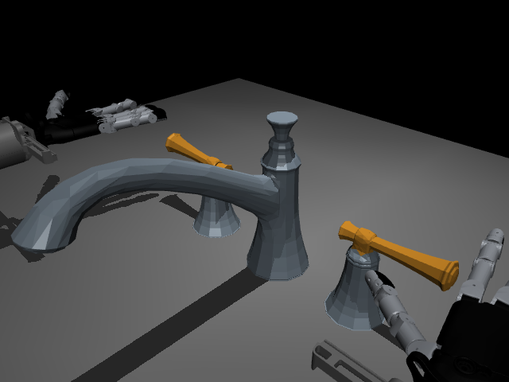
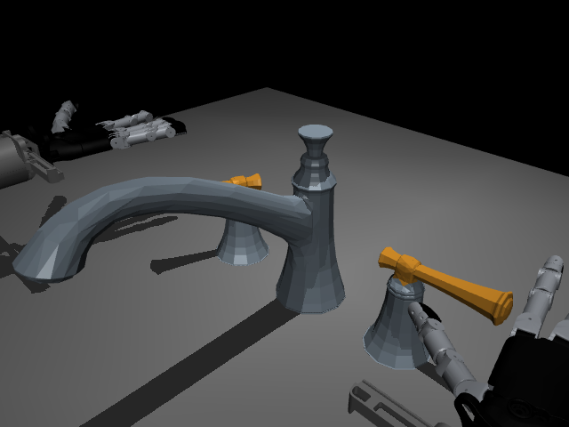

# R02 水龙头：源资产已经接入，任务还没有完成

R02 取自 [Bench2Dex 第 67 个场景](https://github.com/Bench2Dex/Bench2Dex/blob/82e04a2a4e5b728a96ccf1ae7a546762d5a260c7/scenes/67_faucet_cup_water_fill.yaml)中的一个阶段。原任务要求双手先处理勺子和杯子，把杯子放到水龙头下，开关水龙头，再把杯子放上托盘。我们暂时只取“开到指定角度、再关回去”这个可单独测量的子任务，不声称复现了接水或原任务的成功率。原评分代码执行的开关阈值分别是 `joint_0 ≥ 1.0 rad` 和 `joint_0 < 0.52 rad`；源代码头部注释的另一组数字已过时，详见 [R02 任务合同](../tasks/tool_rotation/R02.json)。

之前的占位场景只有一个盒子把手。现在从 [Bench2Dex 官方 Assets 数据集](https://huggingface.co/datasets/Bench2Dex/Assets)固定版本 `bf65215f844d1fca30750e4cc70d7266650abf0a`，逐项校验 10 个文件，共 716,619 字节。官方模型包含固定底座、两个活动把手和 `joint_0`、`joint_1` 两个铰链；源关节范围均为 0–90°，源场景缩放 0.3、固定根节点、密度 300 kg/m³，并为两关节配置阻尼 1.0。原始 USD/URDF 文件由[下载清单](../asset_manifests/R02-bench2dex.json)按需获取，不提交到仓库。数据集页面没有给出单独的资产许可声明，因此不要把 GitHub 代码的 MIT 许可直接套用到这些模型上。



转换时保留了固定底座与两个铰链的层级、轴向和角度范围，把 12 个源碰撞网格分别转成 MuJoCo 凸包；原 USD 铰链禁止父子刚体互撞，因此适配场景也禁用了底座与两个把手之间的碰撞。原 USD 的质量和惯量字段为零，不能直接当成真实物理值：这里按源场景给的密度和转换后凸包体积估算，底座约 0.609 kg、左右把手约 0.027/0.029 kg。源模型贴图没有迁入；图中颜色只为辨认把手。MuJoCo 接触摩擦 0.8 是诊断值，尚未与 PhysX 标定。源 USD 对底座 `visuals` 有一个无法解析的引用；当前可视化使用已校验的碰撞网格，不依赖这个缺失引用。



[4 秒关节运动视频](evidence/source-task-assets-20261126/R02/joint-torque-diagnostic.mp4)是 **直接给水龙头关节施力的机构检查**，不是灵巧手策略，也不能拿它计算任务成功率。MuJoCo 中 `joint_0` 达到约 1.198 rad 后回到约 0.002 rad，初态没有碰撞接触；结果和方法记录在[关节检查数据](evidence/source-task-assets-20261126/R02/joint-torque-diagnostic.json)。UniLab 的两环境短探针完成了加载、推进、独立重置，并从实际物体关节读取 `faucet_joint_rad`，见[运行回执](evidence/source-task-assets-20261126/R02/receipt.json)和[轨迹](evidence/source-task-assets-20261126/R02/traces.json)。短探针没有让手接触把手，轨迹标为不完整，评分仍为 `success=null`。

新机器需先按[机器人准备说明](x5-control.md)生成双 X5/Wuji 模板，并按[资产转换环境说明](source-object-asset-integration.md)准备 `.venv-assets`。之后在仓库根目录运行：

```bash
uv sync --locked
uv run --locked python integrations/unilab/task_assets.py fetch --task R02
.venv-assets/bin/python integrations/unilab/build_source_asset_scenes.py --task R02
uv run --locked python integrations/unilab/task_owner.py smoke --task R02 --output runs/R02-smoke --steps 2
uv run --locked python integrations/unilab/play_task.py --task R02 --port 8080
```

生成器拒绝覆盖已存在的场景；需要重建时先备份 `assets/generated/source_tasks/R02/`。接下来要做的是让 Wuji 手真实接触其中一个把手、在统一初态下完成开关顺序，记录关节角与接触过程，再用同一动作条件对比后端。当前只是源机构接入和观测链路验证，不能据此判断哪个后端更准。
