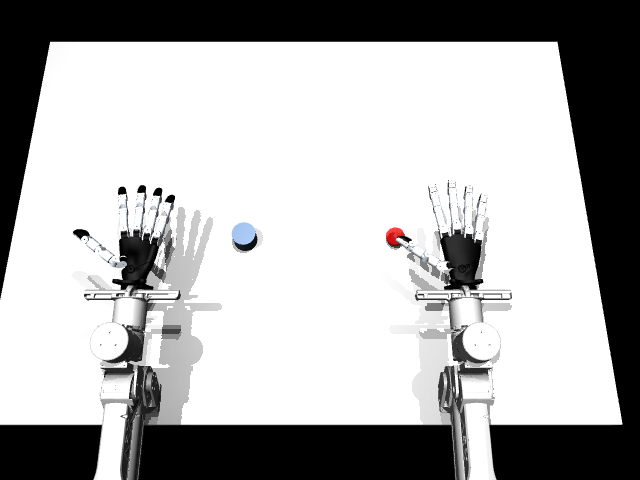

# P02 滑物任务：从 Fetch Slide 到 UniLab 的第一步

原版 [Fetch Slide](https://robotics.farama.org/envs/fetch/slide/) 用 Fetch 机械臂击打桌上的圆柱滑块，让它滑到手臂够不到的目标点。它适合检查接触冲量、桌面摩擦和离手后的运动。我们当前要换成双 X5/Wuji 灵巧手，因此先把源场景中可核对的物理参数带进 UniLab；这仍是场景诊断，没有实现击球策略或任务成功率。

原始 `slide.xml` 和资产许可文件固定在 [P02 manifest](../asset_manifests/P02-fetch-slide-mjcf.json) 所列的 Gymnasium-Robotics Git 提交与 SHA-256。构建脚本读取这份 MJCF，逐项检查滑块为圆柱、半径 0.025 m、半高 0.02 m、质量 2 kg、摩擦 `0.1 0.005 0.0001`、自由关节阻尼 `0.01`；桌面的半长宽为 `0.625 × 0.45 m`、摩擦同上；物理步长为 `0.002 s`。任何这些值与任务布局不符，构建就会失败。这些是源文件参数，不是测得的物理准确性。



这张图由生成的 P02 MJCF 在本地离屏渲染得到，用来核对物体和机器人摆放。当前目标位置、物体初态、X5/Wuji 机器人和桌面高度都是迁移时的固定诊断设置，不等同于 Fetch Slide 原版的随机 reset。原版桌面半厚为 0.2 m，本场景保留原有机器人桌面半厚 0.025 m 和桌面高度 0.765 m，只匹配原桌面的长宽与摩擦。控制周期设为 0.04 s，关节探针只是检查动作、状态读取和 reset。原任务的目标距离小于 0.05 m 的判据写在 [任务合同](../tasks/push/P02.json)，但本场景尚未把滑块位置与目标位置接到这个评分信号，所以回执中成功结果是 `null`。

本次 [UniLab 两环境短试跑回执](evidence/source-mjcf-20261126/P02/receipt.json)记录了加载、两步推进和独立 reset；[状态记录](evidence/source-mjcf-20261126/P02/states.json)可检查滑块、目标、手腕和关节。UniLab 原生 Viser 播放入口也已启动验证。它们证明场景链路可运行，还不能回答灵巧手能否把滑块推到目标，也不能比较不同后端的接触精度。

在新机器上先准备仓库现有的 X5/Wuji 模型依赖，然后从仓库根目录运行：

```bash
uv sync --locked
uv run --locked python integrations/unilab/task_assets.py fetch --task P02
uv run --locked python -m integrations.unilab.build_proxy_task_scenes --task P02
uv run --locked python integrations/unilab/task_owner.py smoke --task P02 --output runs/P02-smoke --steps 2
uv run --locked python integrations/unilab/play_task.py --task P02 --port 8080
```

生成器不会覆盖已有的 `assets/generated/task_proxies/P02`，所以参数变更后应先保留旧版运行记录，再清理并重新生成该目录。下一步是实现与源任务可比的初态和目标采样、Wuji 击球动作，以及物体到目标的实时距离信号。然后才可以固定相同初态与控制轨迹，比较后端的滑移距离、到达误差、接触记录和耗时。
