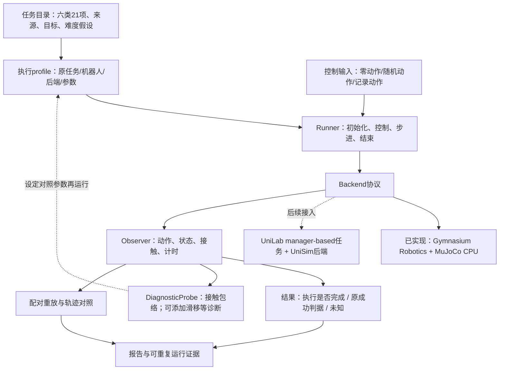

> 历史材料：2026-11-11 至 2026-11-12 的工程记录，状态与路径反映当时版本；当前范围见仓库 README

# 当前工程怎样对应我们的框架

我们要做的是一个覆盖不同接触与操作能力的任务集合。首先把任务本身定义清楚，随后才用同一套任务比较物理后端。难度来自抓取容差、负载与重心、转矩、接触切换和双手协同；不是只把同一个任务的参数改几档

任务目录里的proposed_band是我们用于选题的初步难度假设，不是实验排名。不同机器人和成功协议会改变难度，不能把所有任务的成功率混成一个总分后解释成物理准确性

原任务、灵巧手改编和我们自拟的子任务使用独立协议。尤其要注意：Fetch滑动原本是夹爪任务；Bench2Dex苹果抓取是从完整任务拆出的阶段；扳手紧固仍是拟建任务；旧入盒和交接是相关原型

当前运行代码可保存后端版本、实际参数、动作、初态、终态和诊断。它还没有训练策略，没有完成目标手型迁移，也没有接入UniLab。一次零动作试跑能证明运行链路和记录可用，不能证明机器人具备任务能力
