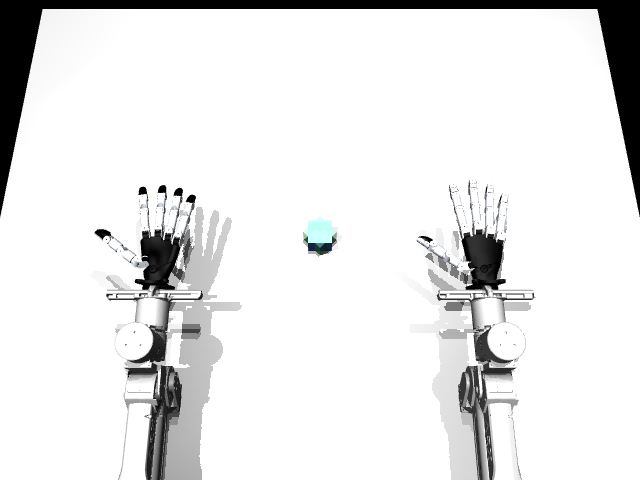

# H01 手内方块：先对齐物体，再准备手内任务

[HandManipulateBlockRotateXYZ](https://robotics.farama.org/envs/shadow_dexterous_hand/manipulate_block/) 的原任务把方块放在 Shadow Hand 掌中，让手指改变它的三维朝向；RotateXYZ 变体只考旋转，不考目标位置。它不能直接换成我们的双 X5/Wuji 场景：手型、掌面接触、初态和动作空间都不同。因此这一步仅迁入可核对的方块参数，保持任务成功未知。

原始 `manipulate_block.xml` 和资产许可文件固定在 [H01 manifest](../asset_manifests/H01-shadow-block-mjcf.json) 的 Git 提交与 SHA-256。原方块是边长 0.05 m 的盒子，密度 567 kg/m³，因此质量为 0.070875 kg；物体接触维度 `condim=4`，自由关节阻尼为 `0.01`。源 XML 没有给该物体单独写摩擦，MuJoCo 3.2.5 编译出的有效值是默认的 `1 0.005 0.0001`。源步长是 0.002 s，求解迭代数为 20，原环境的控制周期是 0.04 s。构建脚本逐项核对源 XML、密度换算、默认摩擦约定和布局配置；与源文件不符就拒绝构建。



图中蓝色方块是动态物体，浅绿色半透明方块只显示一个固定的旋转目标，二者中心相同，不代表需要把物体搬到另一个位置。目标旋转写在刚体姿态上，状态文件记录的目标四元数与画面一致。原环境会采样目标朝向；这里的 45° 绕竖轴显示仅供检查场景。方块仍放在桌面上，而不是 Wuji 掌中；材质颜色也没有移植。因此即使尺寸、质量和部分接触参数相同，当前接触对与原任务也不同，不能比较手内旋转成功率或物理精度。当前 UniLab 使用的 MuJoCo 3.11 也不能直接解析原 XML 中的旧 `apirate` 选项；我们读取参数并生成适配场景，没有声称整体 XML 可直接复用。

[UniLab 两环境短试跑回执](evidence/source-mjcf-20261126/H01/receipt.json)记录了两步推进、状态读取和独立 reset；[审计结果](evidence/source-mjcf-20261126/H01/audit.json)确认两个源文件哈希与场景哈希。Viser 播放入口已启动验证。原任务的旋转角误差小于 0.1 rad 判据保留在[任务合同](../tasks/in_hand/H01.json)，但还没有将方块姿态和目标姿态接成实时评分输入，回执中的成功结果为 `null`。

在准备好仓库的 X5/Wuji 资产后，从仓库根目录运行：

```bash
uv sync --locked
uv run --locked python integrations/unilab/task_assets.py fetch --task H01
uv run --locked python -m integrations.unilab.build_proxy_task_scenes --task H01
uv run --locked python integrations/unilab/task_owner.py smoke --task H01 --output runs/H01-smoke --steps 2
uv run --locked python integrations/unilab/play_task.py --task H01 --port 8080
```

生成器不会覆盖旧的 `assets/generated/task_proxies/H01`。下一步应先设计可重复的 Wuji 掌中放置或抓持初态，再接 RotateXYZ 目标采样与旋转误差；之后需要一个能保持并转动方块的策略，才能评价接触稳定性与后端差异。当前双臂只是统一场景载体，原任务是单只 Shadow Hand，后续对比时必须明确使用哪只手和哪些动作自由度。
