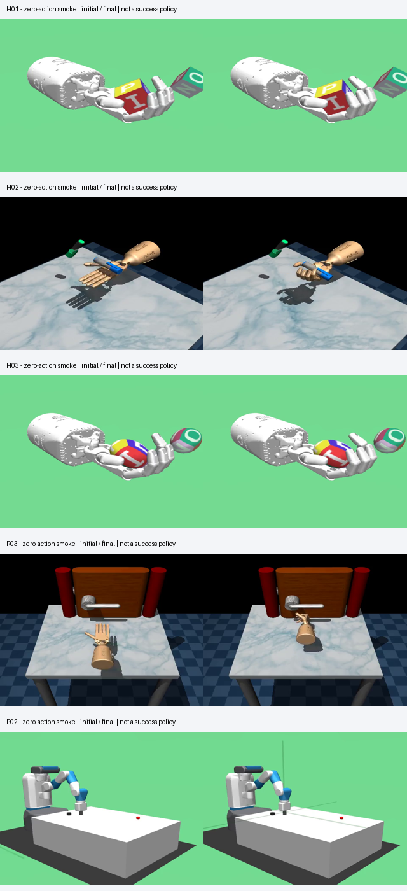

> 历史材料：2026-11-11 至 2026-11-12 的工程记录，状态与路径反映当时版本；当前范围见仓库 README

# 本轮进展

我们已经有一个可以查询任务、运行部分原环境、记录物理观测并保存证据的初版工程。它还不是完整综合benchmark，当前最有价值的进展是把“任务名称”变成了有来源、原始评分和明确实现状态的条目

21项中，19项已核对固定源版本和评分位置；其中5项已执行原环境试跑，其余14项仍停留在来源核对阶段。内部苹果梗和拟建扳手紧固仍需补完整资源/协议

运行的是H01方块、H02笔、H03蛋形物体、R03开门、P02滑动。每项运行零动作seed0、随机动作seed0和随机动作seed1，共15次，均正常结束。它们都没有满足最终成功条件，这是没有使用训练策略或成功演示的结果；本轮没有把这些失败当作引擎性能结论

本轮视频是本机实际MuJoCo渲染，不是下载的官方成功演示：[方块](evidence/videos/H01-zero-smoke.mp4)、[笔](evidence/videos/H02-zero-smoke.mp4)、[蛋形物体](evidence/videos/H03-zero-smoke.mp4)、[开门](evidence/videos/R03-zero-smoke.mp4)、[滑动](evidence/videos/P02-zero-smoke.mp4)

固定环境为Gymnasium Robotics1.4.1、Gymnasium1.2.3、MuJoCo3.2.5、NumPy2.2.6。真实物理步进在本机CPU进行，视频使用本机EGL渲染；不是公司服务器RTX4090的性能数据。完整安装版本见requirements/simulation-lock.txt

接口也做了实际检查：H01同seed同动作重放100步，所有记录刚体的位置和朝向差异为0。把迭代数从20改成1后，轨迹发生明显变化，但初态也变了，因此这里只证明参数覆盖、记录和对照接口生效，不能把差值当成物理误差。比较器会明确标记reset干扰；需要后续固定实际初态才能做更严谨的单变量实验

CPU进程批跑分别用1和2个worker执行4个episode，各完成400控制步。这只验证并发执行、独立输出和汇总；本轮短时运行含进程启动和资源竞争，不给出加速比结论，也不当作GPU并行后端测评

资产方面已定位RoboDojo八项候选的对象路径，并下载29个对象相关文件（约110MB），13个USDZ均通过USD静态读取。插管架、钥匙孔、插座使用SDF碰撞，跨后端时需要保留孔洞结构。Bench2Dex六个来源场景引用25个入口USD，服务器现有8个，其余是尚未在该目录找到，不能说官方没有

接下来先补齐推T、插管和搬运场景的机器人/桌面/材质/layout依赖，再跑原版本。把它们迁到灵巧手时单独记录控制、资产和协议变化。物理同事通过Backend和DiagnosticProbe扩展读数与参数扫描，任务成功判据保持独立

独立代码复核的三项问题已修复并补回归测试：拒绝非有限或错误维度的轨迹、缺失初态标记未知、初始化和视频收尾失败留下不完整运行记录。它们提高证据可靠性，不改变原任务物理或成功判据
