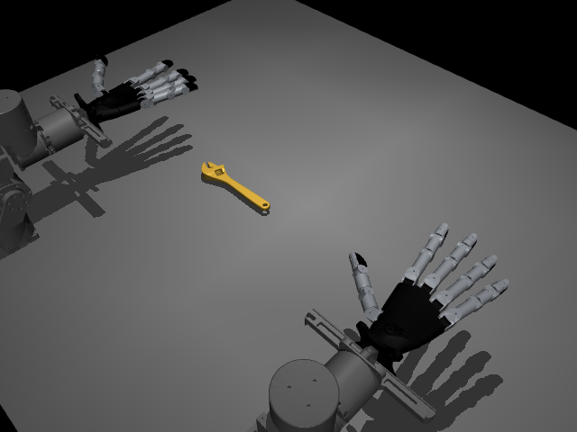
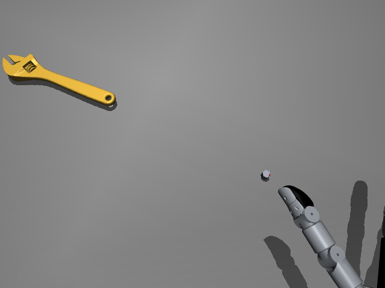

# R01 扳手转动：源工具接入与自拟转轴诊断

R01 的原占位场景把扳手画成一根长方体。现在改为 [RoboDojo 固定版本的可调扳手资产](https://huggingface.co/datasets/RoboDojo-Benchmark/RoboDojo/tree/1127bda94f172d757386945af3eb3a6754d1a4e6/Assets/Object/RoboDojo/Rigid/wrench/00000)，由 [资产清单](../asset_manifests/R01-robodojo-wrench.json)校验 USD 和 metadata。该资产在 RoboDojo 的 *Store Tools In Toolbox* 任务中用于搬运工具；RoboDojo 没有在这里提供“用这把扳手拧螺母”的任务、策略或评分。螺母和转轴是我们为 R01 设计的诊断夹具。





源 USD 的扳手质量为 0.35 kg，摩擦系数 0.45；其碰撞属性要求凸分解。转换脚本保留源网格外形，把碰撞网格先简化到约 5000 三角形，再用固定参数的 CoACD 转成 8 个凸块，并在 MuJoCo 中按凸块体积分摊源质量。源网格的整体边界变化限制在 1 mm 内。这保证场景使用了可追溯的扳手几何，但**没有证明 PhysX 与 MuJoCo 接触等价，也没有校准扳手口径与螺母配合**。

夹具使用自拟的六角螺母：外接圆半径 5 mm，厚度 12 mm，质量 0.01 kg；它绕固定竖直铰链转动，铰链阻尼 0.02、摩擦损失 0.01。螺栓只作视觉提示。螺母与桌面留 2 mm 间隙，因为紧贴桌面时 MuJoCo 接触约束把这个诊断铰链锁住。它不是螺纹模型，不模拟轴向位移和预紧力。数值写在[统一场景配置](../profiles/source_asset_scenes.json)中，后续可明确替换。

[两环境 UniLab 试跑回执](evidence/source-task-assets-20261126/R01/receipt.json)验证了场景加载、两步推进、手腕与物体状态读取、独立 reset，并把实际 `nut_hinge` 角度接到任务合同里的 `nut_rotation_rad`。`wrench_engaged` 尚无几何和接触适配器，因此记录为 `null`；轨迹不完整，任务成功仍为 `null`。这符合[统一评分合同](../tasks/tool_rotation/R01.json)的未知值处理，不会把转轴能动误报成紧固成功。

[直接给螺母铰链施力的视频](evidence/source-task-assets-20261126/R01/mechanism/direct-nut-torque.mp4)与[数据](evidence/source-task-assets-20261126/R01/mechanism/direct-nut-torque.json)只证明自拟转轴能够转动：0.04 N·m 直接关节力矩、2 秒检查，末角约 2.986 rad。视频没有灵巧手抓扳手，也没有通过扳手向螺母传递转矩。它属于机构检查，不能当作 R01 策略或任务成功率。

在新机器上，先按[机器人准备说明](x5-control.md)恢复 Wuji/X5 模型，再运行：

```bash
uv run --locked python integrations/unilab/task_assets.py fetch --task R01
.venv-assets/bin/python integrations/unilab/build_source_asset_scenes.py --task R01
uv run --locked python integrations/unilab/task_owner.py smoke --task R01 --output runs/R01-smoke --steps 2
uv run --locked python integrations/unilab/play_task.py --task R01 --port 8080
```

下一步先标定开口扳手与六角螺母的尺寸和接合区域，再实现 `wrench_engaged` 与手—扳手、扳手—螺母接触事件；随后测试持握、接合、施矩、重抓的完整回合。若要声称真实紧固能力，还需螺纹、轴向进给、扭矩或预紧力参照。物理测评接口可以同时记录法向力、切向滑移、穿透和每步耗时，但当前短探针的这些量仍未采集。
