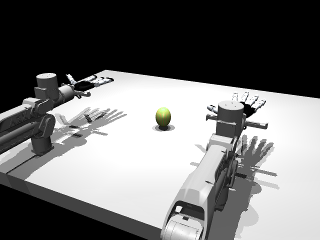

# H03 蛋形刚体：源物体参数迁入场景诊断

[Gymnasium Robotics Manipulate Egg](https://robotics.farama.org/envs/shadow_dexterous_hand/manipulate_egg/) 是 Shadow Dexterous Hand 掌中转动蛋形刚体，使其达到目标朝向的任务。`EggRotate` 变体忽略目标位置，用旋转误差小于 0.1 rad 判定成功。这里的蛋不会破碎，也不是软体。原环境的 20 维动作、掌中初态和随机目标姿态属于完整任务的一部分，目前都没有迁到 Wuji 双手场景。

我从[固定版本源 MJCF 与许可文件](../asset_manifests/H03-shadow-egg-mjcf.json)读取了有碰撞的外层椭球：半轴为 0.03、0.03、0.04 m，源模型按 MuJoCo 默认密度编译出的质量为 0.150796447 kg，主惯量为 `(7.539822e-5, 7.539822e-5, 5.428672e-5) kg·m²`。接触维度为 4，摩擦系数为 `1 0.005 0.0001`，自由关节阻尼为 0.01，物理步长为 0.002 s，求解迭代数为 20。原环境每个动作推进 20 个物理子步，因此本场景的控制周期设为 0.04 s。源文件里另有一个质量为零、关闭碰撞的内部可视椭球；它没有进入适配场景。构建器检查这层仍然不影响动力学，否则拒绝构建。



图中蛋和绿色半透明目标叠在同一个位置，因为这个变体只比较朝向。当前目标角度固定，便于检查记录的姿态；原环境会在 reset 时随机采样。蛋放在诊断桌面，不在手掌上。[两环境短试跑回执](evidence/source-mjcf-20261126/H03/receipt.json)确认加载、两步推进和独立重置，[状态记录](evidence/source-mjcf-20261126/H03/states.json)包含蛋与目标姿态，[审计](evidence/source-mjcf-20261126/H03/audit.json)核对文件。评分输入尚未从 UniLab 读出，回执里的任务成功仍为 `null`，所以这不是原任务的成功复现。

在准备好 X5/Wuji 模型的仓库根目录中可重建场景并打开 UniLab 原生 Viser：

```bash
uv sync --locked
uv run --locked python integrations/unilab/task_assets.py fetch --task H03
uv run --locked python -m integrations.unilab.build_proxy_task_scenes --task H03
uv run --locked python integrations/unilab/task_owner.py smoke --task H03 --output runs/H03-smoke --steps 2
uv run --locked python integrations/unilab/play_task.py --task H03 --port 8080
```

场景构建器拒绝覆盖已有目录。下一步要把蛋放进 Wuji 掌中，并将实际蛋与目标的旋转误差接入任务评分；再增加目标随机采样和可完成任务的控制策略。与源 Shadow Hand 比较时，还要单独核对手型、控制范围和接触行为。
