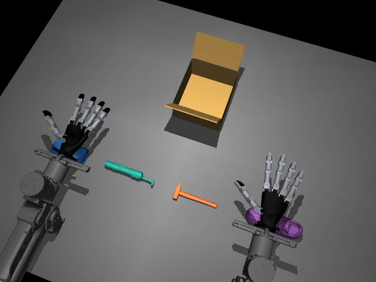
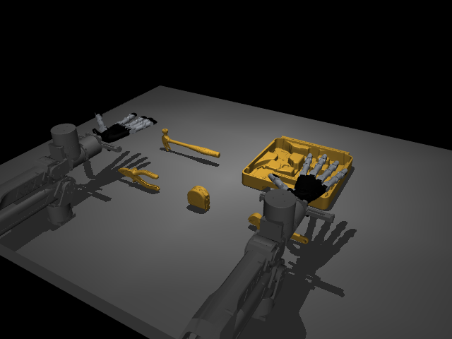
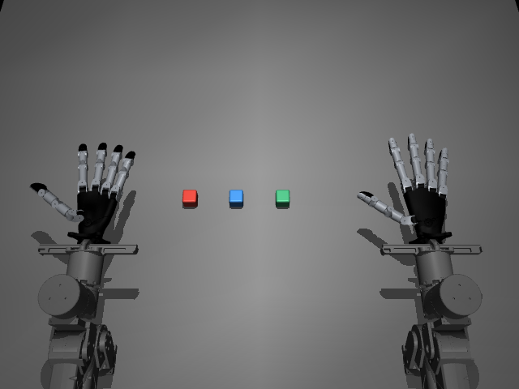
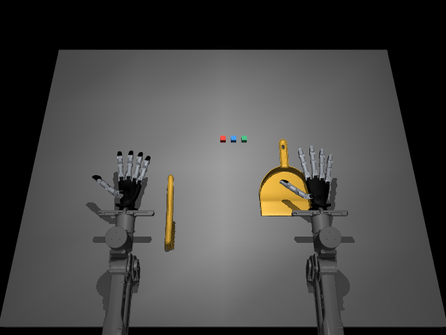

# 六项任务的 RoboDojo 原物体资产接入

目前 21 项任务都能打开场景，其中 P01 推 T 块、I03 插钥匙、M01 装箱、M02 工具归位、M03 堆积木和 P03 扫积木已从自建基础形状切换到 RoboDojo 官方数据中的原物体网格。固定版本的文件清单分别校验通过 6/6、4/4、10/10、10/10、9/9、15/15 项。六项在 UniLab 的 MuJoCo 后端各用两个环境完成加载、两步推进和独立重置。[21 项当前审计](evidence/source-task-assets-20261126/all-tasks-audit.json)明确区分这 6 项、8 项代理场景、2 项插入场景诊断和 5 项本地抓取场景。










这仍是**源物体场景诊断**，不是原任务复现。我们固定了方便检查的初态，保持双 X5/Wuji、关节探针和统一 UniLab Viser 入口；还没有移植 RoboDojo 的随机 reset、任务策略、评分信号或原物理后端。运行回执把成功率和所有未接通的评分输入留为 `null`，不把“场景能动”当成“任务完成”。

接触资产也经过了明确的近似转换。P01 官方 T 块 USD 的碰撞网格标记为关闭，因此这里从原 T 网格尺寸恢复了两个接触盒；它们的组合体积与原 T 网格一致，目标垫只渲染、不参与碰撞。I03 的钥匙和槽在源 USD 使用 SDF 碰撞；MuJoCo 场景改用 CoACD 多凸块，槽生成 48 块时仍超过设定凹度阈值，钥匙孔的有效间隙尚不能认为与源环境一致。I03 还把元数据中 0 的摩擦系数改为 0.45 供当前诊断使用。这些差异都必须先单独对齐，再把任务成绩用于后端比较。

M02 的钳子、锤子、卷尺、扳手和工具箱都来自已校验的源 USD。为了让五个高面数物体可在当前场景中显示，工具网格分别简化到约 2 万面、工具箱到 3 万面，最大包围盒偏差小于 0.14 毫米；源文件本身不变。**碰撞不是源模型**：四件工具暂用源网格外接盒，工具箱暂用开放托盘五盒，内部槽形没有建出来。扳手质量和摩擦取自元数据；钳子、锤子、卷尺的元数据缺少质量和摩擦，当前数值属于明确标注的诊断假设。因此 M02 现在能查场景与运行链路，不能用来评判工具是否真的放入指定槽位或比较物理后端。转换细节见 [M02 场景回执](evidence/source-task-assets-20261126/M02/scene.json)。

M01 先选用记录在 seed-0 源布局里的车 00007、电动牙刷 00002、锤子 00003、鞋 00003 与盒子 00000，而不是下载原任务全部候选物体。源任务要四件物品进入盒底区域，并分别满足方向条件，最后机器人回到初态；当前只把这五件源物体显示在固定、分开的初态。它们的渲染网格简化到每件最多 2 万三角面，碰撞则用物体外接盒和开放式五盒容器近似。源盒体含专门的侧壁碰撞组件，这里的五盒接触并不与之等价。源锤子元数据把质量和摩擦写成 0，当前为了让它作为自由物体参与诊断，显式采用 0.15 千克和摩擦系数 0.45，不能把这两个数当成源任务设定。250 步无控制静置后的最大位置变化约 2.4 毫米，主要来自横放牙刷的落位调整；状态保持有限。盒底功能点、朝向判定、随机 reset 和策略都还未接通，因此没有装箱成功率，也不能拿当前场景比较后端物理精度。详见 [M01 场景回执](evidence/source-task-assets-20261126/M01/scene.json)和[静置检查](evidence/source-task-assets-20261126/M01/passive-stability.json)。

M03 固定了同一 `size0` 尺寸组的 00005、00008、00011 三块积木。原任务配置是先选一个尺寸组，再从中取三个不同实例；这个固定样例符合该取样方式，但不覆盖所有尺寸和随机初态。三块各为 3 厘米、0.2 千克，源 USD 的碰撞近似标记为 `boundingCube`，当前 MuJoCo 接触盒按原网格边界构造，构建时检查该标记。源元数据摩擦写为 0，当前诊断设为 0.45；纹理没有移植，图中的红蓝绿是方便区分物体的显示色，不是原材质。250 步无控制静置后，最大位置变化约 0.11 毫米，说明本地初态没有明显坠落；这不能证明堆叠任务完成或物理后端一致。[M03 场景回执](evidence/source-task-assets-20261126/M03/scene.json)和[静置检查](evidence/source-task-assets-20261126/M03/passive-stability.json)记录了具体数值。

我还核对了 M03 的原始评分代码：`is_stacked` 会按高度排序，检查相邻积木的水平距离和至少 5 毫米的高度差，并不直接检测接触力或释放后稳定性。因此任务得分与我们额外想研究的“真实支撑是否稳定”应作为两个不同指标。当前 M03 的评分输入仍为空值，等待完成信号适配和策略接入。

P03 固定了原任务允许的一把扫帚、一把簸箕和三块小方块。原配置会随机放置并取 3–5 块，这里只检查固定场景。工具源网格分别有约 74 万和 12 万三角面，渲染时简化到 2 万面以内；物体接触更粗略：扫帚暂用外接盒，簸箕暂用五盒开放托盘，方块用 USD 网格边界盒。方块元数据的 `physics.size` 为 35 毫米，但 USD 网格边界约 19.25 毫米；当前还未厘清原环境如何使用这两个尺度，所以不能拿它验证扫入簸箕的成功率或引擎精度。扫帚横放和所有物体位置也是固定诊断初态。250 步无控制静置后各物体位移均低于 0.2 毫米，仅说明当前场景不会立刻失稳。详见 [P03 场景回执](evidence/source-task-assets-20261126/P03/scene.json)和[静置检查](evidence/source-task-assets-20261126/P03/passive-stability.json)。

本机从已下载资产重建场景：

```bash
cd /home/jason77/dexhand_bench
uv venv .venv-assets --python 3.10
uv pip install --python .venv-assets/bin/python -r requirements/scene-assets.txt
uv run --locked python integrations/unilab/task_assets.py audit --task P01
uv run --locked python integrations/unilab/task_assets.py audit --task I03
uv run --locked python integrations/unilab/task_assets.py audit --task M01
uv run --locked python integrations/unilab/task_assets.py audit --task M02
uv run --locked python integrations/unilab/task_assets.py audit --task M03
uv run --locked python integrations/unilab/task_assets.py audit --task P03
.venv-assets/bin/python integrations/unilab/build_source_asset_scenes.py --task P01
.venv-assets/bin/python integrations/unilab/build_source_asset_scenes.py --task I03
.venv-assets/bin/python integrations/unilab/build_source_asset_scenes.py --task M01
.venv-assets/bin/python integrations/unilab/build_source_asset_scenes.py --task M02
.venv-assets/bin/python integrations/unilab/build_source_asset_scenes.py --task M03
.venv-assets/bin/python integrations/unilab/build_source_asset_scenes.py --task P03
uv run --locked python integrations/unilab/play_task.py --task P03 --port 8080
```

新机器上需要先按仓库说明恢复 X5/Wuji 资产，并下载任务源文件；M01 约 77 MB，M02 约 92 MB，M03 约 29 MB，P03 约 52 MB。手动下载时分别使用 `task_assets.py fetch --task M01 --max-total-mb 100`、`task_assets.py fetch --task M02 --max-total-mb 100`、`task_assets.py fetch --task M03 --max-total-mb 35` 和 `task_assets.py fetch --task P03 --max-total-mb 55`。构建脚本为避免覆盖已验证结果，会拒绝写入已有输出目录。`scene.json` 保存源 USD、元数据、转换后网格、机器人和场景的哈希。运行回执分别见 [P01](evidence/source-task-assets-20261126/P01/receipt.json)、[I03](evidence/source-task-assets-20261126/I03/receipt.json)、[M01](evidence/source-task-assets-20261126/M01/receipt.json)、[M02](evidence/source-task-assets-20261126/M02/receipt.json)、[M03](evidence/source-task-assets-20261126/M03/receipt.json)与[P03](evidence/source-task-assets-20261126/P03/receipt.json)。

从新机器完整检查“源文件 → 转换后场景 → UniLab 两步运行”，在机器人与两套 Python 环境准备好后执行 `uv run --locked python scripts/verify_source_asset_integration.py --fetch`。这个检查会在缺少源文件、场景哈希失效或独立重置失败时退出报错；已有场景不会被覆盖。默认单元测试没有下载这些大资产，所以不能代替这条集成检查。

其余代理场景中，[P02 已从 Fetch Slide 源 MJCF 核对滑块和桌面参数](fetch-slide-parameter-adaptation.md)，但仍需要目标和 reset 对齐；另外 7 项仍使用自建基础形状。R02 的 Bench2Dex 资源路径尚未形成可校验的本地物体清单。G06 苹果梗和 R01 扳手紧固需要内部或新建工程资产。H01–H03、R03 可从对应的 Gymnasium Robotics/Adroit 资源继续适配。

I03 的 CoACD 转换即使固定随机种子，重复构建仍可能得到不同的多凸块与场景哈希。回执记录当前具体场景的哈希；比较不同物理后端之前，需要冻结并共享同一份转换后的碰撞资产，不能只给转换参数。
