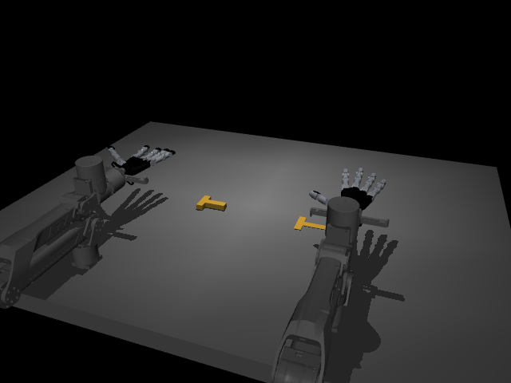
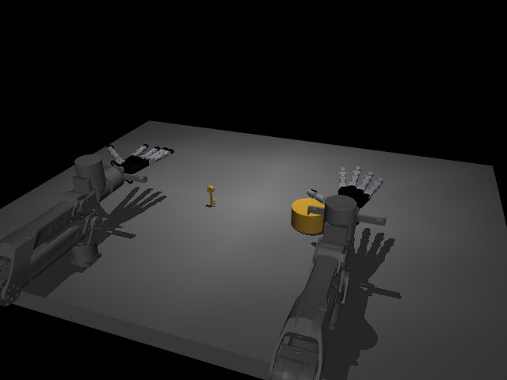

# P01 和 I03 原物体资产接入

目前 21 项任务都能打开诊断场景，其中 P01 推 T 块和 I03 插钥匙已经从自建基础形状切换到 RoboDojo 官方数据中的原物体网格。两项资产分别按固定版本的清单验证：P01 是 T 块与目标垫，6/6 个文件校验通过；I03 是钥匙与槽，4/4 个文件校验通过。两项在 UniLab 的 MuJoCo 后端各用两个环境完成加载、两步推进和独立重置。[21 项当前审计](evidence/source-task-assets-20261126/all-tasks-audit.json)明确区分这 2 项、12 项代理场景、2 项插入场景诊断和 5 项本地抓取场景。画面中的物体来自源 USD，不是之前的方块占位体。





这仍是**源物体场景诊断**，不是原任务复现。我们固定了方便检查的初态，保持双 X5/Wuji、关节探针和统一 UniLab Viser 入口；还没有移植 RoboDojo 的随机 reset、交接与推动策略、评分信号或原物理后端。运行回执把成功率和所有未接通的评分输入留为 `null`，不把“场景能动”当成“任务完成”。

接触资产也经过了明确的近似转换。P01 官方 T 块 USD 的碰撞网格标记为关闭，因此这里从原 T 网格尺寸恢复了两个接触盒；它们的组合体积与原 T 网格一致，目标垫只渲染、不参与碰撞。I03 的钥匙和槽在源 USD 使用 SDF 碰撞；MuJoCo 场景改用 CoACD 多凸块，槽生成 48 块时仍超过设定凹度阈值，钥匙孔的有效间隙尚不能认为与源环境一致。I03 还把元数据中 0 的摩擦系数改为 0.45 供当前诊断使用。这些差异都必须先单独对齐，再把任务成绩用于后端比较。

本机从已下载资产重建场景：

```bash
cd /home/jason77/dexhand_bench
uv venv .venv-assets --python 3.10
uv pip install --python .venv-assets/bin/python -r requirements/scene-assets.txt
uv run --locked python integrations/unilab/task_assets.py audit --task P01
uv run --locked python integrations/unilab/task_assets.py audit --task I03
.venv-assets/bin/python integrations/unilab/build_source_asset_scenes.py --task P01
.venv-assets/bin/python integrations/unilab/build_source_asset_scenes.py --task I03
uv run --locked python integrations/unilab/play_task.py --task P01 --port 8080
```

新机器上需要先按仓库说明恢复 X5/Wuji 资产，并对 P01/I03 运行 `task_assets.py fetch --task <ID>`；构建脚本为避免覆盖已验证结果，会拒绝写入已有输出目录。`scene.json` 保存源 USD、元数据、转换后网格、机器人和场景的哈希。两项运行回执分别见 [P01](evidence/source-task-assets-20261126/P01/receipt.json) 与 [I03](evidence/source-task-assets-20261126/I03/receipt.json)。

从新机器完整检查“源文件 → 转换后场景 → UniLab 两步运行”，在机器人与两套 Python 环境准备好后执行 `uv run --locked python scripts/verify_source_asset_integration.py --fetch`。这个检查会在缺少源文件、场景哈希失效或独立重置失败时退出报错；已有场景不会被覆盖。默认单元测试没有下载这些大资产，所以不能代替这条集成检查。

M02 工具归位的 10 个官方对象文件（约 92 MB）现已[下载并校验](evidence/source-task-assets-20261126/M02-asset-audit.json)；新机器可用 `uv run --locked python integrations/unilab/task_assets.py fetch --task M02 --max-total-mb 100` 恢复。但 M02 仍在代理场景：源 toolbox、hammer、pliers、tape measure、wrench 网格很大，部分对象元数据没有质量与摩擦值，尚不能直接声称可用的接触模型。M01、M03、P03 的已有清单没有文件哈希或大小，需先固定版本和校验后再下载；R02 的 Bench2Dex 资源路径也尚未形成可校验的本地物体清单。G06 苹果梗和 R01 扳手紧固需要内部或新建的工程资产。H01–H03、P02、R03 可从对应的 Gymnasium Robotics/Adroit 资源继续适配。上述任务仍是代理场景，不能与 P01/I03 混为“源资产已接入”。

I03 的 CoACD 转换即使固定随机种子，重复构建仍可能得到不同的多凸块与场景哈希。回执记录当前具体场景的哈希；比较不同物理后端之前，需要冻结并共享同一份转换后的碰撞资产，不能只给转换参数。
