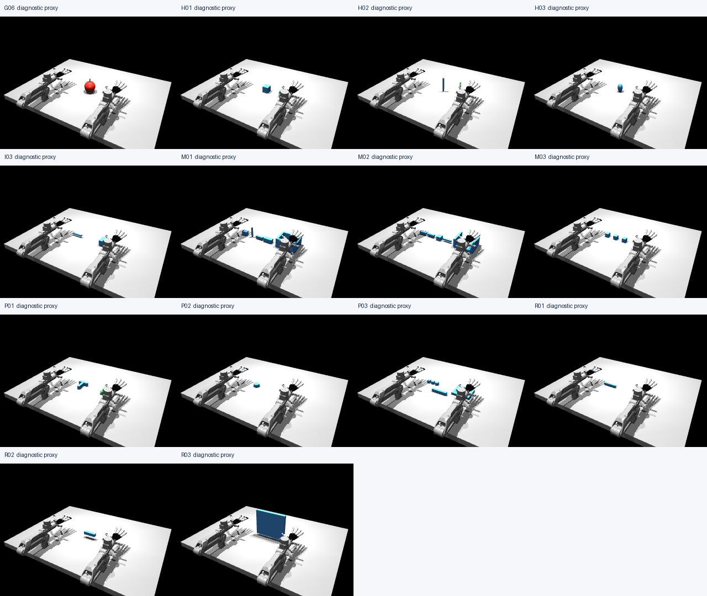

# 14 个后续任务的 UniLab 场景诊断

这 14 项此前只有任务配置与评分合同，没有能在 UniLab 启动的物体场景。现在每项都绑定了双 X5/Wuji 灵巧手、MuJoCo、固定初态、关节探针和 UniLab `ManagerBasedRlEnv`。每个任务在两个并行环境中完成了加载、两步推进、物体与手腕状态读取、独立 reset 检查；[全部任务审计](evidence/task-proxies-20261126/all-tasks-audit.json)和逐项运行回执保留了场景哈希、后端、动作方式和限制。浏览器展示走 UniLab 原生 Viser。

**这些是自建基础形状的场景诊断，不是原任务复现。** 21 份任务 JSON 中的成功、失败和指标规则仍保留；这 14 项还没有与源任务等价的几何/物理模型、reset、策略和评分信号适配器，因此运行记录明确把每个评分信号写为 `null`，成功结果也是 `null`。接触力未采集，同样记录为不可用。代理场景的用途是先验证统一配置、动作、状态读取和运行入口能覆盖不同任务形态，后续逐项替换成可核验的资产和真正的测评。



这张图只展示每个 MJCF 场景的初态，便于检查物体和灵巧手能否加载；不表示完成任务，也不是官方数据的复现画面。

| 类别 | 任务 | 现在可检查的场景骨架 | 进入实际测评前的关键缺口 |
| --- | --- | --- | --- |
| 抓取 | G06 苹果梗 | 苹果球体与细梗 | 内部 SuperDex 资产、夹梗接触和提起策略 |
| 手内操作 | H01 方块、H02 笔、H03 蛋 | 不同物体与目标姿态标记 | 原手型/目标映射、手内重定向策略、角度与位置判据 |
| 插入与交接 | I03 钥匙 | 钥匙与槽的占位体 | 已下载源 USD 的碰撞转换、交接/插入/旋转阶段观测 |
| 搬运 | M01 装箱、M02 工具归位、M03 堆积木 | 多物体、容器与积木 | 源资产、布局、放置/堆叠功能点及完整策略 |
| 推动 | P01 T 块、P02 滑物、P03 扫积木 | T 形接触、滑块目标、扫帚与簸箕 | P01 源碰撞定义；P02 原 Fetch 场景适配；P03 源工具资产与逐块入盒判据 |
| 转动 | R01 扳手、R02 水龙头、R03 门 | 被动转轴与工具/门占位体 | 螺纹/转轴物理、源资产、接触力矩与开锁阶段 |

场景结构由 [diagnostic_proxy_scenes.json](../profiles/diagnostic_proxy_scenes.json) 逐任务声明；[构建脚本](../integrations/unilab/build_proxy_task_scenes.py)生成 MJCF 与带哈希的回执。14 个 [任务 owner](../conf/unilab/task_catalog/) 指向同一类 `unilab_proxy_diagnostic` 入口，[运行脚本](../integrations/unilab/run_proxy_task_scene.py)从 UniLab 读取物体、手腕、关节与步进耗时。统一入口严格区分它与 G01–G05 的抓取场景、I01/I02 的源物体插入诊断。任何任务都不能仅靠 `kind` 或 `backend` 字符串宣称源任务已完成。

原始 X5/Wuji 网格和生成的 MJCF 沿用仓库约定，不提交 Git。新机器需先按[机械臂准备说明](x5-control.md#如何运行)和[Wuji 模型准备说明](wuji-sharpa-hands.md#本机怎么切换)恢复依赖，然后运行 `uv run --locked python -m integrations.unilab.build_proxy_task_scenes --task all`。构建脚本不覆盖已有场景；修改布局后请先备份旧生成目录，再重建受影响任务。

本地复查：

```bash
cd /home/jason77/dexhand_bench
uv run --locked python integrations/unilab/task_owner.py audit
uv run --locked python integrations/unilab/task_owner.py smoke --task P02 --output runs/P02-check --steps 2
uv run --locked python integrations/unilab/play_task.py --task P02 --port 8080
```

下一步优先把 P01 和 I03 已在本地的源资产转成明确的碰撞模型，逐项对齐原 reset，再接通至少一个代表性任务的评分信号。其余任务按可获取资产的顺序迁入。只有同一套任务条件、动作和观测在不同后端都真实可用，才能进一步比较物理误差和吞吐表现。
