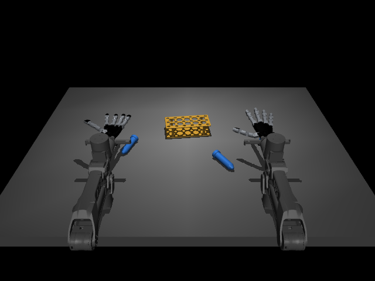
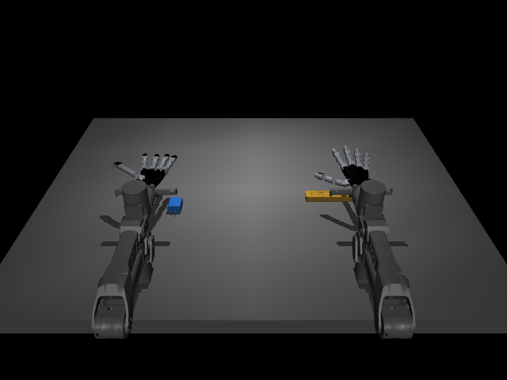

# 其余 16 项任务的 UniLab 迁移状态

我们的 21 项候选任务已经各自有任务 JSON 评分合同和 Hydra 启动配置。配置能通过审计，只说明任务定义完整；必须有场景、机器人、初态、动作、观测和可复查的试跑回执，才算实际接入。以下是 2026-11-26 本地文件和运行结果的快照，完整逐项审计保存在 [all-tasks-audit.json](evidence/I01-wuji-20261126/all-tasks-audit.json)。

| 任务 | 来源与当前可核验材料 | UniLab 状态 | 下一道门槛 |
| --- | --- | --- | --- |
| G06 捏苹果梗提起苹果 | 内部 SuperDex 试验；本仓库无资产清单 | 未绑定 | 向同事取得场景、初态和动作定义；苹果梗目前不是优先项 |
| H01 方块手内重定向 | Gymnasium Robotics；原环境零/随机动作试跑有回执 | 未绑定 | 将原 ShadowHand/方块场景与动作空间映射到目标灵巧手，校准旋转目标与评分 |
| H02 笔手内重定向 | Adroit Pen；原环境零/随机动作试跑有回执 | 未绑定 | 固定 Adroit 模型与笔资产，处理关节/动作重定向和目标姿态 |
| H03 蛋形物体手内重定向 | Gymnasium Robotics；原环境零/随机动作试跑有回执 | 未绑定 | 同 H01，并单独核对蛋形接触几何与目标姿态 |
| I01 插管 | RoboDojo；源物体 4/4 校验通过，转换场景和 Wuji 双臂已加载 | **场景诊断已跑通** | 写插管控制器，核对原几何与回位判据，接触力尚未采集；未得出任务成功结论 |
| I02 插充电器 | RoboDojo；源物体 5/5 校验下载 | **自选布局的场景诊断已跑通** | 保存原框架 seeded reset，复核平面碰撞，写插入控制器和接触力记录 |
| I03 钥匙交接并旋转 | RoboDojo；钥匙与钥匙槽源物体 4/4 已校验，USD 中有启用的碰撞网格 | 未绑定 | 固定原 reset 布局并转换场景，再核对双手交接、插入和旋转阶段 |
| P01 推 T 形块 | RoboDojo；源物体 6/6 校验下载 | 未绑定 | 源 T 块 USD 的碰撞网格被禁用；需确认源实际碰撞几何或制作有标注的替代资产 |
| P02 推滑物体 | Gymnasium Robotics Fetch Slide；原环境零/随机动作试跑有回执 | 未绑定 | 原版是 Fetch 夹爪，需明确灵巧手推物策略及目标区域适配 |
| P03 扫积木进簸箕 | RoboDojo；源物体 0/36 在本地 | 未绑定 | 下载并核对多物体布局、工具接触和逐块入簸箕判据 |
| R01 扳手拧螺母 | 本仓库尚无固定的源任务与资产 | 未绑定 | 先确定可引用的源场景、螺纹/转轴物理模型及扭矩判据 |
| R02 开关水龙头 | Bench2Dex 67；清单目前只有外部 USD 引用 | 未绑定 | 取得数据集、许可与资产哈希，确认水龙头关节和水流代理判据 |
| R03 开门 | Adroit Door；原环境零/随机动作试跑有回执 | 未绑定 | 固定 Adroit 门闩/门轴模型，映射灵巧手动作和门锁阶段 |
| M01 物体装箱 | RoboDojo；源物体 0/57 在本地 | 未绑定 | 先选择固定小规模物体组合，下载资产并核对装箱终态 |
| M02 工具归位 | RoboDojo；源物体 0/10 在本地 | 未绑定 | 下载约 92 MB 固定源资产并转换工具箱接触几何 |
| M03 堆积木 | RoboDojo；源物体 0/45 在本地 | 未绑定 | 先固定积木数和初态，再定义稳定保持时间及接触切换 |





两张图是转换后 MJCF 在 MuJoCo 的初态渲染，用来检查模型是否摆放、加载正确；不是完成任务的画面，也不是官方 RoboDojo 渲染。

I01 的诊断从 Wuji 机器人模板和 RoboDojo 插管物体的转换场景组合 MJCF，再通过 UniLab 的 `ManagerBasedRlEnv` 执行 2 个环境、2 个物理步。记录了三个管各自的包围盒深度代理、在架内判据、竖直角度以及双手腕相对 reset 的回位判据，共 10 个输入。I02 采用同一执行和记录接口，读取充电器深度、是否在插座内、姿态角及双手回位，共 4 个输入。两项的两个环境都有完整观测，无缺失信号，独立 reset 检查通过。评分器输出 `incomplete_trace` 和 `success=null`，因为探针没有完成任务，也没有插入动作。接触力在这两条绑定中标记 `not_instrumented`，不能拿零代替。I01 的证据在[运行回执](evidence/I01-wuji-20261126/receipt.json)和[评测结果](evidence/I01-wuji-20261126/evaluation.json)。

资产转换是下阶段最大的实际工作。RoboDojo 使用 USD/USDZ，UniLab 当前这条运行路径使用 MuJoCo MJCF；几何、碰撞分解、质量、惯量、摩擦和初态必须逐项核对，不能只改文件后缀。I01 已转换为凸碰撞近似，因此能检验数据链路，不能代表源 USD 物理结果。P01 的源 T 形块虽然能下载，USD 碰撞网格却被禁用；如果直接拿可视化网格做碰撞，需要明确记录为自拟替代并重新标定。I02 现在将源充电器与插座碰撞网格转成了 MJCF，并用自选固定位置在 UniLab 试跑；转换时省略了一片零厚度插座碰撞面，固定插座为满足 MuJoCo 编译添加了账面质量。这证明运行接口可用，不能代表源物理接触或官方随机初态。I02 的[场景回执](evidence/I02-wuji-20261126/receipt.json)和[评测结果](evidence/I02-wuji-20261126/evaluation.json)都保留了这个边界。

下一步优先处理 I02 的源 reset 对齐和插入控制器，并验证省略的平面碰撞如何影响接触。P01 要先解决碰撞定义。H01/H02/H03/P02/R03 的原环境回执只能证明原版可启动，灵巧手动作重定向仍需单独做。这样推进时，每项可以明确停在“资产齐备”“场景加载”“评分信号就绪”或“有策略且可跑完整任务”的哪一层。

本地可复查命令：

```bash
cd /home/jason77/dexhand_bench
uv sync --locked
uv run --locked python integrations/unilab/task_owner.py audit
uv run --locked python integrations/unilab/task_assets.py audit --task I02
uv run --locked python integrations/unilab/task_assets.py audit --task P01
uv run --locked python integrations/unilab/task_owner.py smoke --task I01 --output runs/I01-smoke --steps 2
uv run --locked python integrations/unilab/task_owner.py smoke --task I02 --output runs/I02-smoke --steps 2
uv run --locked python integrations/unilab/play_task.py --task I02 --port 8080
```

`task_assets.py fetch --task <ID>` 只对有 URL、哈希和大小的清单工作；下载上限默认 25 MB，较大资产需显式给 `--max-total-mb`。R02 这类仅有外部路径的清单会拒绝下载，避免把未核验文件当成官方资产。I01 需要先按既有转换脚本生成 `assets/generated/I01-convex` 与 `assets/generated/dual_x5_wuji`，再运行 `uv run --locked python integrations/unilab/build_insert_wuji_scene.py`。I02 的资产转换另需 `.venv-assets/bin/python integrations/unilab/build_i02_wuji_scene.py`，物理试跑仍走仓库根目录的 `uv run --locked`。
最后一条通过 UniLab 自带的 Viser 入口打开浏览器，只演示探针动作，不产生任务成功报告。

资产转换使用独立的 uv 环境，避免 USD 原生库与 UniLab 运行依赖互相覆盖；新机器先执行 `uv venv --python 3.10 .venv-assets`，再执行 `uv pip install --python .venv-assets/bin/python -r requirements/scene-assets.txt`。双臂 Wuji 模板的准备见[灵巧手资产说明](wuji-sharpa-hands.md)。生成物放在 `assets/generated/`，仓库不把本机绝对路径的 MJCF 当成可移植源文件；转换脚本和哈希清单才是可重建依据。
