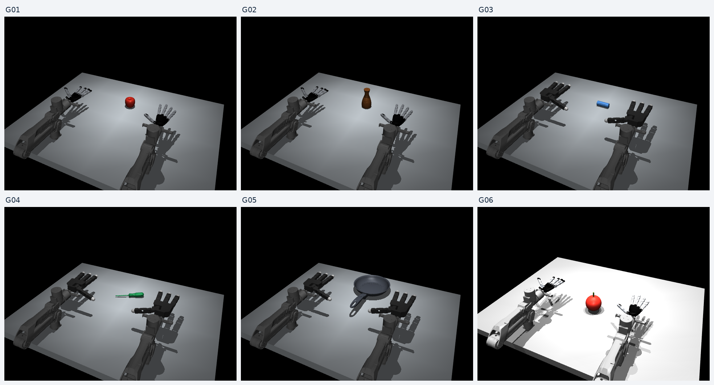
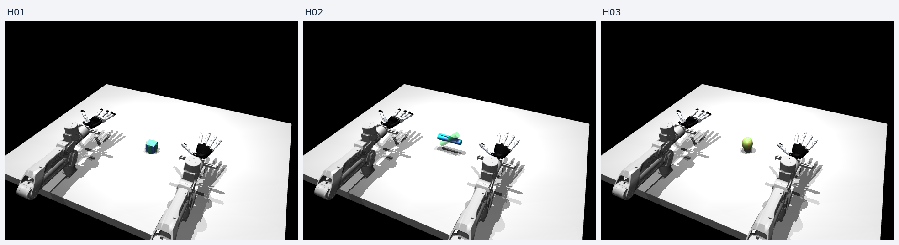
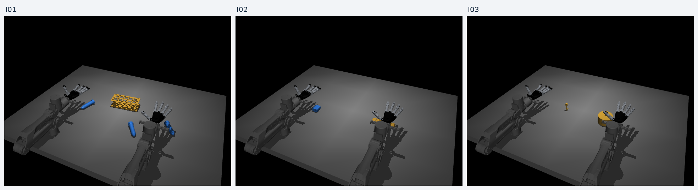
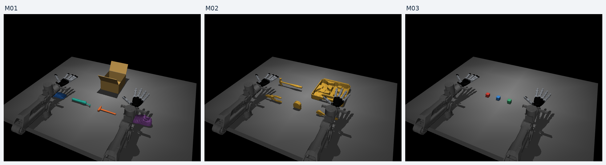
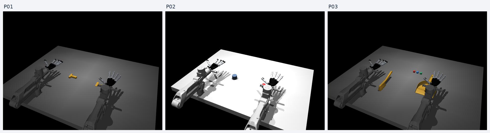
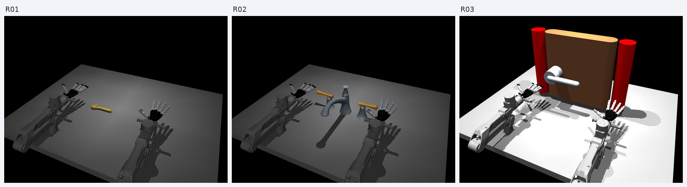

# 11.27 weekly report

这周我把前面定的 21 个任务逐一对应到当前的 UniLab 场景配置，并按六类重新截了图：抓取 6 项、手内调整 3 项、插入 3 项、搬运 3 项、推动 3 项、工具与旋转 3 项。它们现在都能在本机加载当前绑定的 MJCF 场景；截图是这些场景的**初始状态**，不是 21 个任务都已经由策略做成功了。现在真正有固定初态 IK 抓取尝试的是 G01 苹果和 G02 瓶子；其余场景主要用来检查机器人、物体、关节和评分信号能否接起来。

以下图片由 MuJoCo EGL 对 **UniLab 任务配置实际绑定的 MJCF** 离屏渲染，统一视角、没有推进任务。每个任务的单张原图、场景哈希和生成方式保存在 [`weekly-scenes-20261127`](../evidence/weekly-scenes-20261127/manifest.json)。

我目前最想先解决的是**资产看起来对，但接触时未必对**。原项目用 USD、PhysX 或自己的 MJCF 场景；迁到 UniLab 的 MuJoCo 后，物体外观可以保留，孔、槽、钳口和工具边缘的碰撞形状却可能被凸包或盒子近似改变。这样会直接影响能否插入、抓稳或施力，所以现阶段不能用这些任务的分数直接比较后端。

目前最明确的几处问题：

- **G06 苹果梗**：当前是我们自建的球体加细杆；同事 SuperDex 测试用的苹果、果梗连接和质量参数没有拿到，因此还不能做对照。
- **R01 扳手拧螺母**：扳手是 RoboDojo 原资产，螺母和转轴是我们自建的。现配置 10 mm 螺母与钳口明显不匹配；两侧同时接触的静态检查仍需约 2.30 mm 穿透。要先定匹配尺寸或换工具，再谈施矩成功率。
- **I03 钥匙插槽**：源 USD 用 SDF 表示凹槽；当前改用多个凸块，即使分到 48 块，凹度仍未达设定阈值。钥匙孔的有效间隙还不能认为与原环境一致。
- **M02 工具归位**：工具和工具箱外形来自 RoboDojo，但箱内各槽的碰撞还没建出来，当前是开放托盘；因此不能按“工具进指定槽”评分。部分工具质量和摩擦还用了诊断假设。
- **P03 扫积木**：源小方块元数据写 35 mm，网格边界约 19.25 mm，尺度含义尚未对齐；扫帚和簸箕接触也分别用盒子、开放托盘近似。

另外几类是**已接入源资产，但还要核对物理等价性**：G01–G05 的 Bench2Dex 物体用了转换后的碰撞和统一建议摩擦；I01/I02 的插孔与原 SDF 碰撞不等价，I02 还省掉一片平面碰撞体；M01 的箱子用了五盒近似、锤子质量是诊断值；P01 的 T 块用两个接触盒；R02 的水龙头保留了双铰链，但原质量字段为零，当前按密度估算，贴图未迁入。M03 的积木尺寸和质量接近源设定，但摩擦、颜色和随机初态仍是本地适配。

H01–H03、P02、R03 已参考原 MJCF 的主要物体或机构参数，但机器人、物体初态、目标采样和任务流程改成了当前诊断版。特别是 R03 目前只有开门角度的结果输入，门闩解锁阶段还没有单独判定。G01/G02 当前绑定 Wuji 手，G03–G05 是 Allegro 手；后面做横向比较时要先统一手型或把手型作为实验变量。

下一步先把上述几处影响接触几何的缺口补齐，冻结同一份碰撞资产、尺寸、初态和成功规则，再让相同任务配置切换后端。现在的统一入口和评分合同已经有了雏形，但后端测评目前只实际接通 MuJoCo；控制策略与完整任务回合仍要逐项补。这样做的顺序是先确认“测的是同一道题”，再比较哪个物理后端更快、更稳、误差更小。
